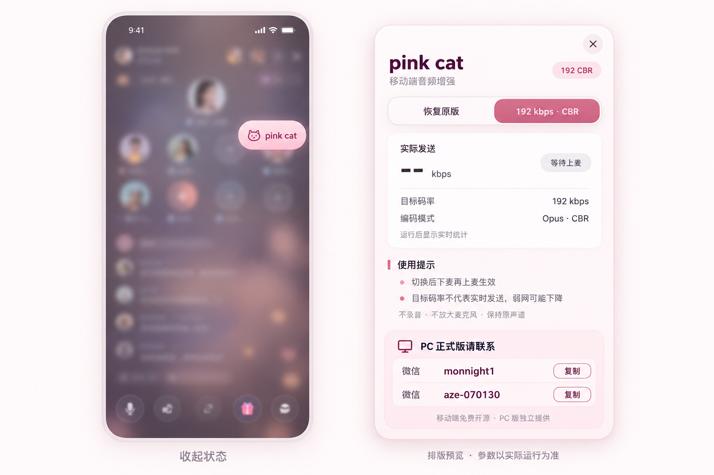

# pink cat · iOS

轻量的 TT 移动端音频控制浮层。**192 kbps CBR / 恢复原版**，无其他码率档位。

## 功能

- 可拖动的 `pink cat` 悬浮按钮，默认收起。展开为白粉圆角面板。
- 首次默认选择 192；之后记住选择。切换不会中断当前通话，下麦再上麦生效。
- 显示 SDK 实际发送统计；旧统计失效后显示 `--`，不把目标值冒充实测。
- 只有当前主发布流的原生参数确认后才显示 `Opus · CBR`。原版、待生效、兼容错误有独立提示。
- 不录音、不放大麦克风、保持原声道数量，不读账号/密码，不包含联网回传或授权系统。
- PC 联系方式为独立卡片。仅点击“复制”时写入所选微信号，不读剪贴板、不自动跳转微信。

**PC 正式版请联系**：微信 `monnight1` / 微信 `aze-070130`。PC 版独立提供，不在本仓库中。

## 下载

- [直接下载 PinkCatAudio.dylib](https://raw.githubusercontent.com/xidrc12345/pink-cat-ios/main/releases/v1.0.0/PinkCatAudio.dylib)
- [版本发布页与完整使用包](https://github.com/xidrc12345/pink-cat-ios/releases/tag/v1.0.0)
- [SHA256 校验文件](releases/v1.0.0/SHA256.txt)

## 安装 / 替换

1. 完全退出 TT，先移除之前的注入库。不要叠加加载多个版本。
2. 使用你现有的巨魔注入工具，将发行包中的 `PinkCatAudio.dylib` 注入目标应用，然后重启 TT。本仓库不提供安装器或其他设备的部署功能。
3. 打开 `pink cat` 面板，在自己的房间上麦。参数通常在下一次发布、原生回调命中后生效，统计以 SDK 回调为准。
4. 恢复原版：选“恢复原版”，下麦再上麦；彻底移除：退出 TT，删除注入项，再启动。

## 支持边界

- 构建目标：arm64，iOS 16.0+，目标 bundle `com.yiyou.tt`。
- 当前仅识别 SDK `3.25.0.51876`，UUID `06DDCBA1-5782-3D86-86CA-C98BA166CA7E`。**不是所有 TT 版本通用**。
- 原生控制只接受已识别的主流 Opus 对象，48 kHz、原声道、原 PCM；有 UUID、指令签名、虚表和对象归属检查。
- 本库不绕过 192 上限、不强行覆盖 SDK 的自适应降档。不保证弱网、小声、静音时实际发送恒定为 192。
- 原版可能使用 AAC；192 模式请求 Opus。接收端兼容性、听感必须单独确认。
- ad-hoc 签名不等于 Apple 开发者签名，实际加载取决于你的注入环境。

## 验证状态

本地 arm64 构建、Mach-O / ad-hoc 签名页校验、主机模拟断言通过，结果见 `docs/validation/`。

**本次新版真机注入、UIKit 绘制/触控、持续发送和接收端听感尚未验收。** 发行版本号用于区分代码，不代表已完成真机验证。

## 源码入口

- `src/PinkCatAudio.m`：SDK 回调、品牌面板、复制交互、偏好与本地诊断。
- `src/PanelPolicy.h`：可单测的布局与状态展示逻辑。
- `src/AudioPolicy.h`：仅 0/192 两个选择及统计合法性检查。
- `src/NativeCodec.h`：编码线程上的 CBR/DTX 控制与恢复。
- `src/NativeLayout.h` / `NativePolicy.h`：版本特征、布局与边界检查。
- `src/MiniApple.h` / `link-stubs/`：最小公共 ABI 声明和链接符号列表，不包含 Apple SDK 实现。
- `build.py` / `run_tests.py` / `verify_macho.py`：构建、主机模拟测试与分发校验。

构建命令见 [BUILD.md](BUILD.md)，实现和性能边界见 [架构](docs/ARCHITECTURE.md)。公开前检查 [发布说明](docs/RELEASE.md) 和 [安全说明](SECURITY.md)。

## 许可

本仓库自行编写的代码采用 MIT，见 `LICENSE`。TT、Zego、Apple 的名称和各自软件属于其权利人；本项目不是官方客户端或合作产品。第三方 SDK/应用二进制、录音、账号数据、私钥、PC 正式版源码均不包含在本仓库。
